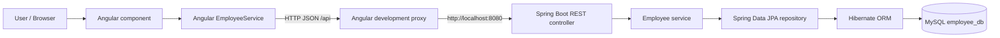
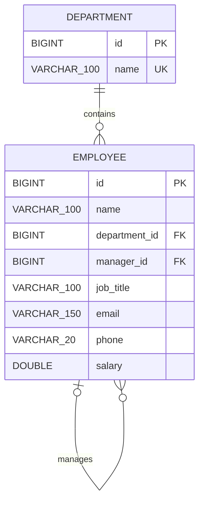

# Employee Management System
## University Project Report

## 1. Cover Page

| Field | Details |
|---|---|
| Project title | Employee Management System |
| Student name | Suhas G T |
| USN / Register number | 1BM25CD110 |
| Course / lab / batch | **SKILL LAB** |
| Submission date | **2026-10-24** |
| Development environment | GitHub Codespaces |
| GitHub repository | [suhasgt1/Employee-Management-System-](https://github.com/suhasgt1/Employee-Management-System-) |

> This report describes the implemented project. Genuine screenshots remain for the student to capture. Test results below distinguish automated/API checks from browser actions that were not performed.

## 2. Abstract

The Employee Management System is a web application for creating, viewing, updating, and deleting employee records and departments. Its standalone Angular frontend uses TypeScript, HTML, CSS, and Bootstrap. It sends JSON requests to a Java Spring Boot REST API. Spring Data JPA and Hibernate map `Employee` and `Department` entities to related MySQL tables; employees reference a department and may reference another employee as their manager. Employee records include job title and contact details, with validation on both the frontend and backend. A Docker Compose service and a Codespaces development container provide a repeatable student development environment. Automated backend tests use an isolated H2 database, while the application itself uses MySQL for persistent storage.

## 3. Problem Statement

Employee details maintained in paper registers or disconnected spreadsheets can be difficult to search, update, and keep consistent. Manual changes also make it harder to confirm that a record was saved or removed. A small database-backed application provides a clear interface for those basic record operations and demonstrates how a web frontend communicates with a backend service.

## 4. Proposed Solution

The application provides a browser-based employee form and table. Angular sends HTTP requests through a same-origin development proxy to Spring Boot. The backend validates the request, applies CRUD logic through a service, and accesses MySQL through a Spring Data JPA repository. API responses return to Angular, which updates the table and displays success or error messages.

The solution is intentionally limited to employee records. It does not use React, JSON Server, mock API responses, seeded fake employee records, or browser-only persistence.

## 5. Objectives and Project Scope

### Objectives

- Implement Create, Read, Update, and Delete (CRUD) operations for employee data.
- Demonstrate a separate Angular frontend, Spring Boot REST API, and relational database.
- Validate input in both the browser and backend.
- Preserve employee records in MySQL across page refreshes.
- Run the required development tools and MySQL service in GitHub Codespaces.

### Scope

The application manages departments and employees with a self-referencing manager relationship. Its scope excludes employee login, roles, payroll, leave management, pagination, and production deployment.

## 6. Target Users and Use Cases

The intended users are a student demonstrating a full-stack lab project and an evaluator checking basic record management.

| Actor | Use case | Result |
|---|---|---|
| Administrator / demonstrator | Create employee | Valid employee data is sent to the API and saved in MySQL |
| Administrator / demonstrator | List or retrieve employee | Saved employee details are displayed |
| Administrator / demonstrator | Update employee | The selected record is updated while its ID is preserved |
| Administrator / demonstrator | Delete employee | The user confirms, then the record is removed after API success |
| Student / evaluator | Verify persistence | MySQL query shows saved employee records |

## 7. Software and Hardware Requirements

### Software

- GitHub Codespaces with the repository's `.devcontainer` configuration.
- Java 21 and Maven.
- Node.js 22 and npm.
- Docker and Docker Compose for MySQL 8.4.
- A modern browser for the Angular interface.
- Git/GitHub for source control.
- Optional MySQL client for inspecting the database.

The required tools are provided in the configured Codespace; installing Java, Maven, Node.js, or MySQL on a student's Windows computer is not necessary when using Codespaces.

### Hardware

A computer with a supported browser and internet access to GitHub Codespaces. Memory, processor, and disk requirements depend on the selected Codespaces machine size; no specialized hardware is required.

## 8. Technologies Used

| Technology | Actual role |
|---|---|
| HTML | Angular component template structure for labels, form controls, messages, buttons, and the employee table |
| CSS | Custom typography, colors, spacing, focus states, table appearance, and responsive layout |
| TypeScript | Angular models, form and request logic, loading and message state, and service method types |
| Angular | Standalone application and component framework, template binding, lifecycle, and `HttpClient` integration |
| Bootstrap | Responsive grid, form controls, table, alerts, buttons, and loading spinner styles |
| Java 21 | Backend programming language |
| Spring Boot 3.5 | Application startup and REST API hosting |
| REST / HTTP | JSON request/response contract between the Angular service and backend endpoints |
| Spring Data JPA | Repository interface and standard CRUD persistence operations |
| Hibernate | JPA implementation that maps the entity to MySQL and updates the development schema |
| MySQL 8 | Persistent relational database for employee records |
| Maven | Backend dependency management, compilation, testing, and packaging |
| npm | Angular dependency installation and frontend scripts |
| Git and GitHub | Source versioning and repository hosting |
| GitHub Codespaces | Cloud development environment for Java, Maven, Node.js, and Docker |

## 9. Frontend Implementation

The frontend is an Angular standalone application under `frontend/`. The `Employee` and `Department` TypeScript interfaces match the API responses, and employee payloads include department and optional manager IDs. `EmployeeService` uses Angular `HttpClient` and relative `/api` URLs.

The employee component loads employees and departments during initialization, supports adding departments, submits creates and updates, fills the form when Edit is selected, cancels edits, asks for confirmation before deletion, and refreshes the list after successful operations. The form allows selecting an optional manager; the table displays employee name, department, manager, job title, contact details, salary, and ID.

The employee name, department, and job title must be nonblank and at most 100 characters. Email must be valid and at most 150 characters. Phone must contain exactly 10 digits. Salary is required and must be numeric, non-negative, no greater than 999999999999.99, and have at most two decimal places. Managers must be existing employees, and manager cycles are rejected. Department names must be nonblank and unique. The submit button is disabled for invalid input or while saving.

## 10. Backend Implementation

The Spring Boot project is in `backend/` and uses the package `com.bmsce.employeemanagement`.

- **Entities:** `Department` stores normalized unique department names. `Employee` references a department and an optional manager, as well as its contact and salary data.
- **Repository:** `EmployeeRepository` extends `JpaRepository<Employee, Long>`; ordinary CRUD uses Spring Data rather than handwritten SQL.
- **Service:** `EmployeeService` contains list, find, create, update, and delete operations. Updates load the existing entity and retain its ID. Missing IDs raise a meaningful not-found exception.
- **Controller:** `EmployeeController` exposes the REST routes and validates request bodies with `@Valid`.
- **Exception advice:** `ApiExceptionHandler` returns client-safe messages for validation errors, malformed requests, bad path values, unsupported methods, missing records, and unexpected errors. Unexpected server details are logged server-side and are not included in the response.

The frontend proxy is the one development connectivity strategy; controller CORS is not enabled.

## 11. REST API Endpoints

Base URL inside the Codespace: `http://localhost:8080/api/employees`.

| HTTP method | Endpoint | Operation | Success status |
|---|---|---|---|
| GET | `/api/employees` | List employees | `200 OK` |
| GET | `/api/employees/{id}` | Retrieve one employee | `200 OK` |
| POST | `/api/employees` | Create an employee | `201 Created` |
| PUT | `/api/employees/{id}` | Update an employee | `200 OK` |
| DELETE | `/api/employees/{id}` | Delete an employee | `204 No Content` |
| GET | `/api/departments` | List departments | `200 OK` |
| POST | `/api/departments` | Create a department | `201 Created` |

Validation and malformed requests return `400 Bad Request`; an unknown employee ID returns `404 Not Found`. Error responses contain a timestamp, status, error category, safe message, and request path, not a stack trace or database credential.

Example request:

```json
{
  "name": "Ananya Rao",
  "departmentId": 1,
  "managerId": null,
  "jobTitle": "Software Engineer",
  "email": "ananya@example.com",
  "phone": "9876543210",
  "salary": 45000
}
```

This is documentation-only sample input; it is not seeded into the application.

## 12. Database Schema and Entity

The database is `employee_db`; fresh installations use [database/setup.sql](../database/setup.sql). Back up existing databases from the prior schema, then run [database/migrate-employee-relations.sql](../database/migrate-employee-relations.sql) before starting the updated application. The migration can complete a partially upgraded schema and is safe to rerun.

| Column | Java field/type | MySQL type | Meaning and constraint |
|---|---|---|---|
| `id` | `Long` | `BIGINT` | Primary key, generated with identity/auto-increment |
| `name` | `String` | `VARCHAR(100)` | Required, nonblank employee name |
| `department_id` | `Long` | `BIGINT` | Required foreign key to `departments.id` |
| `manager_id` | `Long` | `BIGINT` | Optional self-referencing foreign key to `employees.id` |
| `job_title` | `String` | `VARCHAR(100)` | Required, nonblank job title |
| `email` | `String` | `VARCHAR(150)` | Required, valid email address |
| `phone` | `String` | `VARCHAR(20)` | Required, exactly 10 digits |
| `salary` | `Double` | `DOUBLE` | Required; minimum 0 and maximum 999999999999.99 |

The `departments` table contains a generated primary key and unique, required name. Each employee belongs to exactly one department and may report to one other employee. The API rejects manager cycles; deleting a manager retains direct reports with no manager.

Verify stored data with:

```sql
SELECT e.id, e.name, d.name AS department, m.name AS manager, e.job_title, e.email, e.phone, e.salary
FROM employee_db.employees e
JOIN employee_db.departments d ON d.id = e.department_id
LEFT JOIN employee_db.employees m ON m.id = e.manager_id;
```

The project uses `Double` because that is the specified field type. For a production payroll system, a fixed-precision `DECIMAL` type would be preferable for currency.

## 13. CRUD Implementation

| Operation | Frontend behavior | Backend/database behavior |
|---|---|---|
| Create | Validates and submits the employee form | Validates JSON, inserts row, returns `201` and the saved entity |
| Read | Loads the list on page initialization and after changes | Reads ordered rows; retrieves an individual ID when requested |
| Update | Edit loads a record; Save Changes sends updated fields | Loads the existing row, applies fields while preserving ID, returns `200` |
| Delete | Requests confirmation and waits for API success | Deletes the existing row and returns `204`; missing ID returns `404` |

The list is refreshed after successful create, update, and delete responses. The UI does not remove a row before a delete request succeeds.

## 14. Architecture and Data Flow



### Request and response flow

1. A user action in the Angular template invokes the component.
2. The component validates input and calls `EmployeeService`.
3. `HttpClient` sends an HTTP JSON request to `/api/employees`.
4. The Angular development proxy forwards the request to the Spring Boot controller on port 8080.
5. The controller validates the request body and calls the service.
6. The service applies CRUD logic through the repository; Hibernate maps the operation to MySQL.
7. MySQL returns the stored result. The repository, service, and controller return the appropriate HTTP status and JSON response.
8. Angular receives the response, refreshes the employee list, and shows success or error feedback.

### Entity relationship diagram

The schema normalizes department names and represents manager/report relationships with foreign keys:



## 15. Validation and Exception Handling

Frontend validation requires a nonblank employee name, selected department, and job title, a valid email address, exactly 10 phone digits, and a non-negative numeric salary with at most two decimal places. The backend independently validates these fields and relationship IDs, rejects manager cycles, and prevents duplicate department names.

The global REST exception handler gives a `400` response for missing or invalid fields, malformed JSON, and invalid path values. A missing employee ID returns `404`. Unsupported HTTP methods return `405`. Unexpected exceptions are logged on the server and return a generic `500` message without exposing internal details.

## 16. Testing Methodology and Actual Results

The backend integration tests use the `test` Spring profile with an in-memory H2 database, so the Maven tests do not use or delete a developer's MySQL records. Separate checks started the Compose MySQL service and Spring Boot application, exercised REST requests with `curl`, verified the updated record directly in MySQL, and confirmed the Angular development proxy returned the API response.

### Executed checks

| Test | Expected result | Actual result | Status |
|---|---|---|---|
| Backend integration suite | CRUD, response codes, validation, malformed request, and not-found behavior pass using H2 | 3 tests ran; 0 failures, 0 errors | PASS |
| Backend package | Maven compiles, runs tests, and creates the application JAR | `mvn package` succeeded; 3 tests passed | PASS |
| MySQL container health | MySQL reports healthy and accepts connections | MySQL 8.4.13 reported healthy; `mysqladmin ping` succeeded | PASS |
| REST create/list/read/update/delete | Correct status codes and updated values | GET 200, POST 201, GET-by-ID 200, PUT 200, DELETE 204 | PASS |
| REST validation | Invalid name/department/salary request is rejected | Blank name and negative salary request returned 400; individual constraints also passed integration tests | PASS |
| Missing employee | Unknown ID returns 404 | GET to an unused ID returned 404 with a safe message | PASS |
| MySQL persistence | Updated employee row is visible in MySQL before deletion | SQL query found the updated test row; only that temporary row was then deleted | PASS |
| Angular API proxy | `/api/employees` through port 4200 reaches Spring Boot | `curl http://localhost:4200/api/employees` returned HTTP 200 and `[]` | PASS |
| Angular production build / TypeScript | Production bundle builds and TypeScript compiles | `npm run build` succeeded; component CSS emitted a non-blocking size-budget warning | PASS |
| Browser manual UI CRUD and refresh | Form operations work in a browser and persist after refresh | Not performed with browser automation in this environment | NOT RUN |
| Genuine screenshot capture | Eight screenshots show this live application | Must be captured by the student in the Codespace | NOT RUN |

The current Angular build tool pins an older transitive `undici` release, so `frontend/package.json` overrides it to the patched compatible 7.30.1+ line. A complete `npm audit` after the override reported no vulnerabilities. This lab dependency check is not a production security assessment.

## 17. Screenshots and Captions

No fake screenshots are embedded. Capture each image from the actual running Codespace application and save it in `screenshots/`.

1. **Project setup — `01-project-setup.png`:** editor shows backend packages and Angular source structure.
2. **Homepage — `02-homepage.png`:** employee form and list/empty state in the browser.
3. **Create — `03-create.png`:** successful create message and the new row.
4. **Read/list — `04-list-read.png`:** saved record displayed after retrieval or page refresh.
5. **Update — `05-update.png`:** updated record with its original ID.
6. **Delete — `06-delete.png`:** list after confirmed deletion.
7. **API — `07-api-evidence.png`:** successful API response or Spring Boot request evidence.
8. **Database — `08-database-evidence.png`:** MySQL `employees` query and result.

Replace these captions with the evidence you actually captured.

## 18. GitHub Repository

Repository: [https://github.com/suhasgt1/Employee-Management-System-](https://github.com/suhasgt1/Employee-Management-System-)

The source is versioned with Git and hosted on GitHub. Review and commit the current changes, then push only when ready. Do not include `.env`, credentials, tokens, employee personal data, dependencies, or build output.

## 19. Installation and Execution

The supplied environment is GitHub Codespaces. If this repository's dev-container configuration was added after the Codespace was created, rebuild the container once.

**Terminal 1, repository root:**

```bash
docker compose up -d mysql
docker compose ps
```

Wait for MySQL health status `healthy`.

**Terminal 2, repository root:**

```bash
cd backend
mvn spring-boot:run
```

**Terminal 3, repository root:**

```bash
cd frontend
npm install
npm start
```

Open the forwarded Angular port **4200**. The backend API runs on port **8080**. The UI calls relative `/api` URLs and the frontend dev proxy forwards those calls to Spring Boot. For custom credentials, copy `.env.example` to `.env` and load it in the backend terminal. The root README and `START_HERE.md` cover setup and troubleshooting.

## 20. Limitations

- No authentication, authorization, user accounts, or role management.
- No employee search, pagination, bulk import/export, or department entity.
- Salary uses the requested `Double` type; fixed-precision currency arithmetic would be better for real payroll.
- Hibernate `ddl-auto=update` and `root`/`root` are development defaults only.
- No frontend unit-test runner or automated browser test is configured.
- No real UI screenshots have been captured in this session.
- A scoped npm override is used to keep the Angular 21 build tool on the patched `undici` dependency line until Angular updates its pin.

## 21. Future Enhancements

- Add authentication, authorization, and secure role-based access.
- Add search, sorting, and pagination for larger employee lists.
- Use a fixed-precision decimal for salary and database schema migrations for releases.
- Add automated Angular unit and browser end-to-end tests.
- Add audit history and controlled validation messages where required.
- Configure production deployment, secret management, monitoring, and backups.

## 22. Conclusion

The project demonstrates a full-stack CRUD workflow using Angular, Spring Boot, REST, Spring Data JPA, Hibernate, and MySQL. It provides backend integration tests, server-side and client-side validation, database-backed persistence, and a Codespaces setup. The backend and persistence checks and Angular build were executed successfully. Browser-driven UI operations and screenshot evidence remain to be completed by the student and must not be claimed as tested until captured.

## Report Conversion

This Markdown file is the complete editable report source. Word and PDF exports are not included; generate them from this report if your submission requires those formats.

To create a Word document and PDF on a computer with Pandoc installed:

```bash
pandoc docs/PROJECT_REPORT.md -o PROJECT_REPORT.docx
pandoc docs/PROJECT_REPORT.md -o PROJECT_REPORT.pdf --pdf-engine=xelatex
```

The PDF command also requires a compatible LaTeX PDF engine such as `xelatex`. Alternatively, generate the Word document with Pandoc, open it in Microsoft Word or LibreOffice Writer, and use **Save As / Export as PDF**. Review page breaks, Mermaid diagrams, tables, and screenshot captions after conversion.
